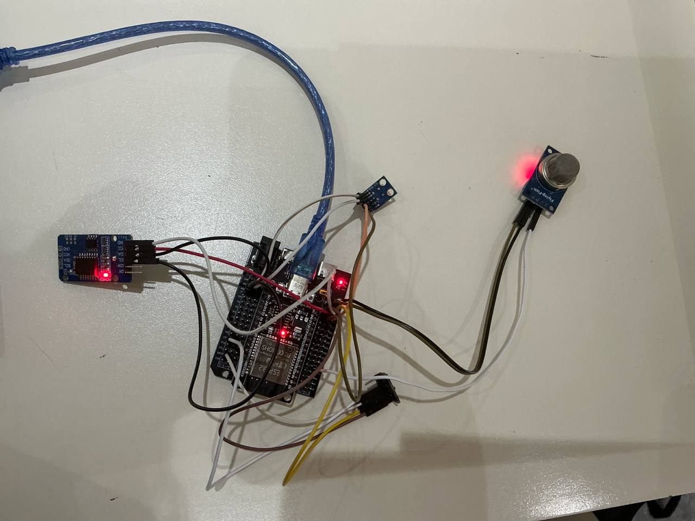
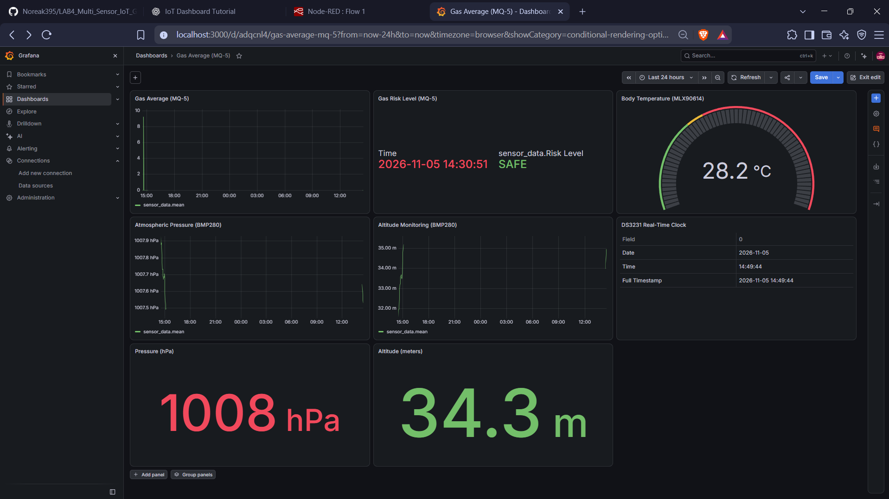

# LAB4_Multi_Sensor_IoT_Grafana-Group-2

## LAB 4: Multi-Sensor IoT Monitoring with Grafana Dashboard

### 1. Overview
In this lab, students will design and implement a multi-sensor IoT monitoring system using ESP32 and MicroPython (Thonny). The system integrates MLX90614 (body temperature), MQ-5 (gas sensor), BMP280 (room temperature, pressure, altitude), and DS3231 (RTC).
Students must implement edge logic processing before sending data to Node-RED, where it will be stored in InfluxDB and visualized in Grafana.

### 2. Learning Outcomes (CLO Alignment)
- Integrate multiple I2C and analog sensors with ESP32.
- Implement moving average filtering for noisy sensor signals.
- Create rule-based classification logic at the edge.
- Structure JSON packets for IoT transmission.
- Store time-series data in InfluxDB.
- Design dashboards using Grafana.

### 3. Equipment
- ESP32
- MLX90614
- MQ-5 gas sensor
- BMP280
- DS3231 RTC
- Breadboard and jumper wires
  
  

### 4. System Description
The ESP32 continuously reads sensor data from all modules. Before sending data to Node-RED:

1. Gas readings are filtered using a moving average (last 5 samples).
2. Gas level is classified as SAFE, WARNING, or DANGER.
3. Fever detection logic is applied to body temperature.
4. Pressure and altitude are transmitted normally.
5. Timestamp is generated using DS3231.

Processed data is sent to Node-RED, stored in InfluxDB, and visualized in Grafana.

### 5. Tasks & Checkpoints

#### Task 1 - Gas Filtering (Moving Average)
- Read MQ-5 using ESP32 ADC (12-bit).
- Store the last 5 readings.
- Compute moving average.
- Print raw and averaged value.
- Send averaged value to Node-RED.

**Evidence:** Serial Monitor screenshot showing raw vs. average values.

#### Task 2 - Gas Risk Classification

**Classification Rules:**
- Below 2100 → SAFE
- 2100–2599 → WARNING
- 2600 or above → DANGER
- Send `risk_level` with data packet.

**Evidence:** Screenshot demonstrating different risk states.

#### Task 3 - Fever Detection Logic
- If `body_temp >= 32.5°C` → `fever_flag = 1`
- Else → `fever_flag = 0`
- Send `fever_flag` to Node-RED.

**Evidence:** Demonstration of fever detection logic.

#### Task 4 - Pressure & Altitude Monitoring (Grafana)

## Grafana Dashboard Panels

### 1. Gas Average (Time Series)
.png>)

### 2. Risk Level Display

### 3. Body Temperature Gauge

### 4. Pressure Graph

### 5. Altitude Graph

### 6. Pressure (hPa) from BMP280
 from BMP280.png>)

### 7. Altitude (meters)
.png>)

### 8. DS3231 Timestamp

   Grafana Dashboard 
   

**Evidence:** Screenshot of complete Grafana dashboard.
[Watch Project Demonstration](https://youtube.com/shorts/0n-_p600KQ4?si=rU7hHUkn8I-MIfE5)

### 6. Submission & Academic Integrity

Students must submit:

- `main.py` (MicroPython source code)
- Flowchart (Important)
- Node-RED flow export file
- Screenshot of InfluxDB data
- Screenshot of Grafana dashboard
- `README.md` explaining system logic
- Short demo video (60–90 seconds)

All submitted work must be original. Code sharing is strictly prohibited.
